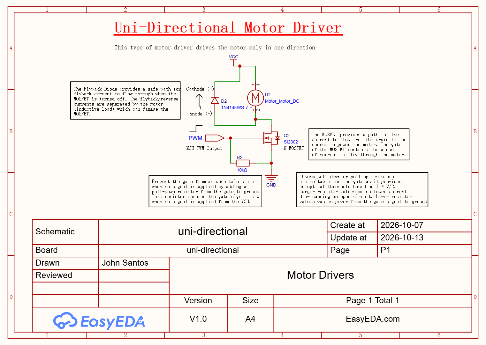
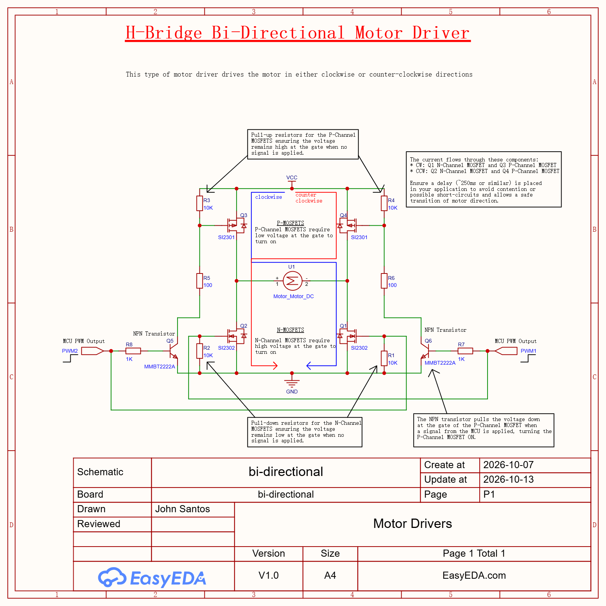

Concepts
========

Metal Oxide Semiconductor Field-Effect Transistor (MOSFET)
-----------------------------------------------------------

The MOSFET is a type of transistor that controls the amount of current flowing through a circuit.
It has 3 terminals: the gate, the drain, and the source. The gate terminal controls the flow of current between the drain and source terminals. 
When a voltage is applied to the gate, it creates an electric field that allows current to flow from the drain to the source in an N-channel MOSFET.

The MOSFET can also be referred to as a switch that turns a signal on or off.

Motors and Lenz' Law
---------------------

Motors are inductive loads as represented by this equation:

.. math::

   V = L\frac{di}{dt}

Choose a set of motors whose stall currents won't exceed the maximum current rating 
of the motor driver. The stall current can be measured by applying maximum voltage
to the motor and gently stopping the motor shaft using a set of pliers to see the current measured.

Motors drivers provides the following advantages:

* High current switching
* Flyback protection
* Overcurrent protection
* Thermal protection
* PWM control
* Direction control

Uni-directional Motor Driver
-----------------------------

These types of motor drivers drive the motors in one direction only. They are typically 
used in applications where the motor only needs to rotate in a single direction, 
such as in conveyor belts or simple robotic arms or RC drones/planes.

This motor driver includes a flyback diode to drive the flyback/reverse currents
generated when the MOSFET is turned off though the diode from the anode to the cathode
to prevent any damages to the MOSFET. Furthermore, this motor driver includes
a pull-down resistor at the gate to prevent any uncertain states when there
is no signal at the gate. The pull-down resistor pulls the signal down to ground
to ensure the gate at the MOSFET remains closed.

Bi-directional Motor Driver
----------------------------

These types of motor drivers can drive the motors in both directions (CW and CCW). 
They are commonly used in applications where the motor needs to rotate in both directions, 
such as in RC cars with forward or reverse mobility, bidirectional conveyor systems, or any 
application requiring forward and reverse motion.
         

This motor driver provides two paths for current to flow through the motor
allowing the motor to spin in either direction. The path is as follows:

* Clockwise: Q1 N-channel MOSFET and Q3 P-channel MOSFET are turned on to allow the current to flow from the + to - terminals of the motor.
* Counter-clockwise: Q2 N-channel MOSFET and Q4 P-channel MOSFET are turned on to allow the current to flow from the - to + terminals of the motor.

We can never allow P-channel and N-channel MOSFETs on the same side of the bridge to turn on as this will cause a short 
circuit because of the absence of a load.

P-channel MOSFETs turn on when voltage is low and N-channel MOSFETs turn on when voltage is high. 
To allow the same signal from the MCU to control both types of MOSFETs, we can use a NOT gate (NPN transistor connected directly to ground)
to drive the voltage at the gate of the P-channel MOSFET low when signal from the MCU is high, thus turning the P-channel MOSFET on.
The signal from the MCU can be connected directly to the N-channel MOSFET as these types of MOSFETs will turn on when signal is high.

Pull-down resistors are placed at the gate of the N-channel MOSFETs to avoid uncertain states when no signal is applied at the gate. This ensures
the N-channel MOSFET remains off. Similarly pull-up resistors are placed at the gate of the P-channel MOSFETs to ensure the MOSFET remains off 
when no signal is applied.
