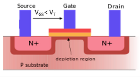
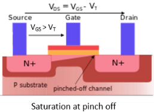
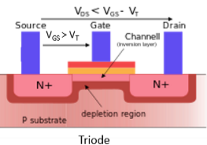
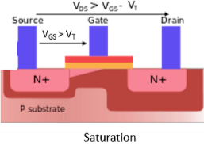
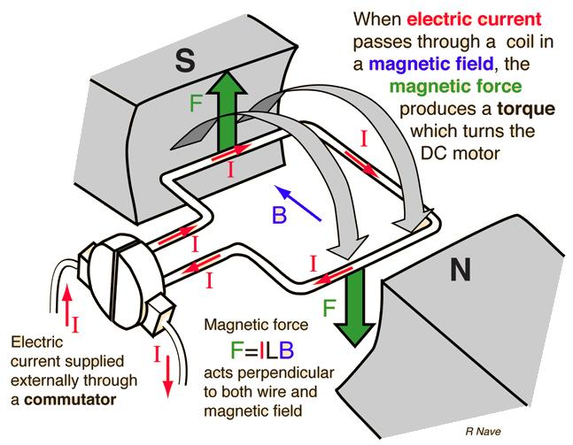
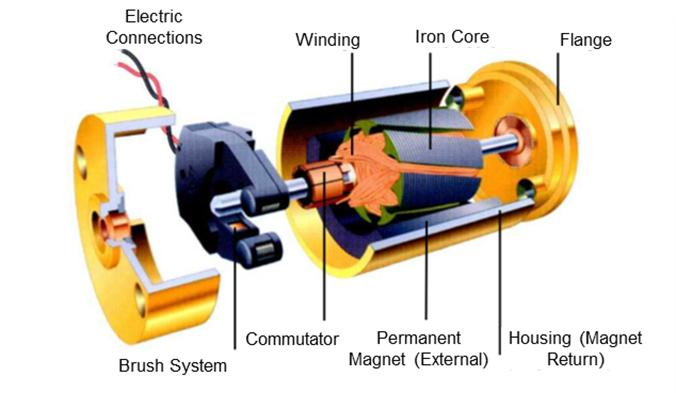
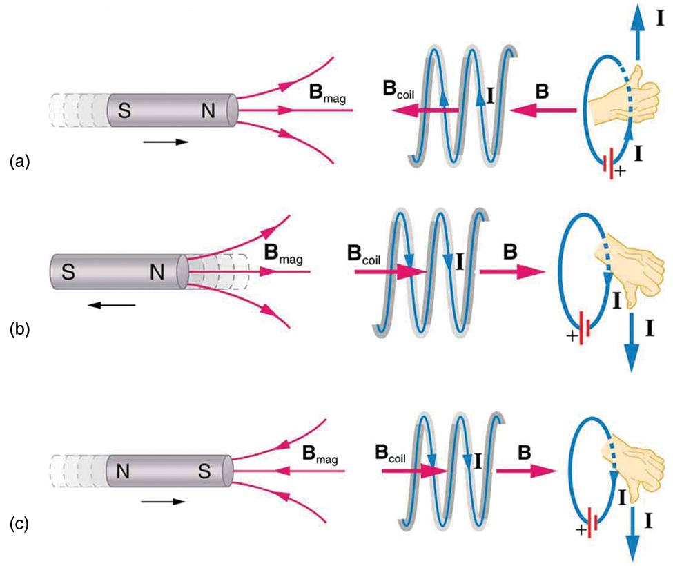

Concepts
========

Metal Oxide Semiconductor Field-Effect Transistor (MOSFET)
-----------------------------------------------------------

The MOSFET is a type of transistor that controls the amount of current flowing through a circuit.
It has 3 terminals: the gate, the drain, and the source. The gate terminal controls the flow of current between the drain and source terminals. 
When a voltage is applied to the gate, it creates an electric field that allows current to flow from the drain to the source in an N-channel MOSFET.

The MOSFET can also be referred to as a switch that turns a signal on or off.

N-type Doping
^^^^^^^^^^^^^^

N-type doping starts with a silicon crystal which is stable by having 8 valence 
electrons. Each silicon atom consists of 4 valence electrons, but through covalent
bonding, the electrons are shared achieving 8 valence electrons.

Then N-type doping is done by injecting other elements such as phosphorus with 5 
valence electrons to produce 9 valence electrons in the overall structure. This 
results in one net electron leaving the entire structure negatively charged.

P- type Doping
^^^^^^^^^^^^^^^

P-type doping also starts with a silicon crystal and injected with an element such as
Boron with 3 valence electrons. This produces 7 valence electrons in the overall
structure. This results in a debt of one electron from a stable structure, leaving
the entire structure positively charged.

Design
^^^^^^^^

An N-channel MOSFET consists of a base P-type material and an N-type drain and source materials.
The N-type drain and source are connected to the P-type base material causing PN junctions to form
where the two materials meet.

The PN junction forms when electrons from the N-type material move towards the P-type material.
When electrons move towards the base and holes move towards the N-type material, an electric field
forms preventing further the movement of charges. The PN-junction is also known as the depletion
region. The region where mobile charges are absent.

For an N-Channel MOSFET, the source is connected to ground. When voltage is applied
from source to drain, there is no current flow at the source because it is grounded, but
current flows to the drain. Adding more electrons to the drain, increasing the depletion region at the drain.
The cutoff voltage is the voltage which current does not flow towards the drain.

The gate is separated from the base with a Silicon Dioxide layer. This layer has an extremely
high resistance preventing current from flowing through the gate. 

When voltage is applied at the gate, an electric field forms acting as a capacitor. This 
electric field creates a positive terminal at the gate, thus attracting electrons from
the base to the top of the structure forming a channel from source to drain. As the voltage
at the gate increase this forms a large enough channel for electrons to flow from source to drain.
The voltage which allows current to flow is the threshold voltage.

The gate voltage must be connected back to ground to introduce electrons at the gate thus 
dissipating the channel from source to drain.

The point at which the channel is at the maximum capacity is the Ohmic region. Eventually
current stops increasing at the saturation region at the specific voltage. Current can only
be increased by increasing voltage.

The saturation region occurs when an electric field forms because of the voltage that
forms from drain to source (VDS). This voltage is formed because of the moving electrons
from source to drain. The electric field pushes the electrons from source to drain
thus increasing the depletion region (reducing channel size) near the drain.

Motors and Lenz' Law
---------------------

A brushed DC motor generates torque through the interaction between the magnetic field 
produced by current flowing through the armature coils and the magnetic field of the permanent magnets.

1. Stator (permanent magnets) : provides stationary magnetic fields from the north and south poles.
2. Rotor (armature) : consists of an iron core and copper windings - the current flowing through the windings produces a magnetic field.
3. Commutator : segmented copper ring that reverses the current direction at every half turn to flip the direction of the magnetic force rotating the motor. The commutator connects with the armature and contacts the brushes.
4. Brushes : conductive contacts that transfer electrical current from the power supply to the rotating commutator.

Motors are inductive loads as represented by this equation:

.. math::

   V = L\frac{di}{dt}

This means that counteractive forces are introduced to reduce the changes of the system and preserves conservation of energy.

* Electromagnetic Induction: the production of a voltage (EMF) when the magnetic flux through a conductor changes.
* Lenz' Law: The induced current flows in a direction that produces a magnetic field opposing the change in magnetic flux that caused it.

An induced current is caused by an induced electric field which is created by a changing magnetic field.

A changing magnetic field induces a circular electric field. When the MOSFET is turned off, 
this can induce an electric field which can generate large voltage spikes and "flyback" currents
that can damage the MOSFET. This makes the design of the motor driver important to introduce protective
components that keeps the MOSFET away from harm.

Motors drivers provides the following advantages:

* High current switching
* Flyback protection
* Overcurrent protection
* Thermal protection
* PWM control
* Direction control
* MCU pins does not supply enough current to drive the motors, motor drivers uses a separate power supply to drive the motors

Choose a set of motors whose stall currents won't exceed the maximum current rating 
of the motor driver. The stall current can be measured by applying maximum voltage
to the motor and gently stopping the motor shaft using a set of pliers to see the current measured.

Uni-directional Motor Driver
-----------------------------

These types of motor drivers drive the motors in one direction only. They are typically 
used in applications where the motor only needs to rotate in a single direction, 
such as in conveyor belts or simple robotic arms or RC drones/planes.

.. image:: assets/SCH_uni-directional_motor_driver.png
   :align: center
   :alt: Uni-directional Motor Driver

This motor driver includes a flyback diode to drive the flyback/reverse currents
generated when the MOSFET is turned off though the diode from the anode to the cathode
to prevent any damages to the MOSFET. Furthermore, this motor driver includes
a pull-down resistor at the gate to prevent any uncertain states when there
is no signal at the gate. The pull-down resistor pulls the signal down to ground
to ensure the gate at the MOSFET remains closed.

Bi-directional Motor Driver
----------------------------

These types of motor drivers can drive the motors in both directions (CW and CCW). 
They are commonly used in applications where the motor needs to rotate in both directions, 
such as in RC cars with forward or reverse mobility, bidirectional conveyor systems, or any 
application requiring forward and reverse motion.
         
.. image:: assets/SCH_bi-directional_motor_driver.png
   :align: center
   :alt: Bi-directional Motor Driver

This motor driver provides two paths for current to flow through the motor
allowing the motor to spin in either direction. The path is as follows:

* Clockwise: Q1 N-channel MOSFET and Q3 P-channel MOSFET are turned on to allow the current to flow from the + to - terminals of the motor.
* Counter-clockwise: Q2 N-channel MOSFET and Q4 P-channel MOSFET are turned on to allow the current to flow from the - to + terminals of the motor.

We can never allow P-channel and N-channel MOSFETs on the same side of the bridge to turn on as this will cause a short 
circuit because of the absence of a load.

P-channel MOSFETs turn on when voltage is low and N-channel MOSFETs turn on when voltage is high. 
To allow the same signal from the MCU to control both types of MOSFETs, we can use a NOT gate (NPN transistor connected directly to ground)
to drive the voltage at the gate of the P-channel MOSFET low when signal from the MCU is high, thus turning the P-channel MOSFET on.
The signal from the MCU can be connected directly to the N-channel MOSFET as these types of MOSFETs will turn on when signal is high.

Pull-down resistors are placed at the gate of the N-channel MOSFETs to avoid uncertain states when no signal is applied at the gate. This ensures
the N-channel MOSFET remains off. Similarly pull-up resistors are placed at the gate of the P-channel MOSFETs to ensure the MOSFET remains off 
when no signal is applied.

PWM Signals
------------

Why use PWM signals to the gate pin of the MOSFET? 
PWM signals allows us to efficiently provide average motor power. Let's define 
the following DC logic levels.

* 5V -> MOSFET is on (motors at 100% fully powered)
* 0V -> MOSFET is off (motors are not powered)

What if we want to power the motor only at 50%? If we pass 2.5V to the gate,
then the MOSFET is 50% ON. Though this seems logical to achieve 50% motor power, but
it is highly inefficient. A MOSFET that is not fully open adds resistance to the current
which can result to wasted power. 

.. math::

   P = I^2 R

Let's say the internal resistance is 1ohm at the MOSFET powered at 2.5V, this results in a power loss of 1W.
However, if the internal resistance is 0.01ohm at the MOSFET powered at 5V, this results in a power loss of only 10mW.
A fully powered MOSFET is very efficient, and in order to achieve 50% power to the motor, we provide a 50% duty cycle
to the gate of the motor. This means that the MOSFET switches ON for 1/2 of the period and OFF for the other 1/2 of the period.
Thus on average, the motor is only receiving 50% of the power from the power supply for any given time.

Voltage is supplied at the gate because the gate acts like a capacitor to control the MOSFET. High internal resistance
prevents any current from flowing through the gate.

Furthermore, if the PWM is set to 20KHz, this doesn't mean that the motor instantly accelerate or decelerate 20,000x per second. 
Mechanical inertia smoothes the motor into continuous rotation.

